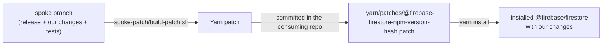

# Firestore performance patch

The `spoke` branch of this fork carries changes to `@firebase/firestore` that Spoke applies to the published package as a Yarn patch. With them, each server update costs work in proportion to what changed, instead of to every listener and document the client holds. `patch-header.txt` describes each change, how it was checked and what it measured.

## How it fits together



What the main change does, per server update:

```diff
 for each listener's view
-  re-check every document it holds for limbo
+  re-check only the documents this update touched
```

Every patch starts with a banner naming the branch, commit and base release it was built from, and the command that rebuilds it. The rest of the header describes each change, how it was checked and what it measured.

## What the checks prove, and what they don't

| Check | What it shows |
| --- | --- |
| Firestore's unit and spec suites | Our build gives the same results as the release, in memory and with persistence |
| `view_upstream_diff`, `view_review_cases` | Our View and the release's View give the same results, limbo changes and errors on the same steps |
| `view_limbo_fuzz` | The incremental limbo update matches a full recompute after every call |
| `key_in_filter_fuzz` | The indexed `documentId() in` / `not-in` filters match a plain `isEqual` scan, errors included |
| `doc_overloads` | `doc(collectionReference, undefined)` does not compile |
| `build-patch.sh` base build | The release built here is byte-identical to the published package, so the patch holds only our changes |

One limit: `upstream_view.ts` copies only the View class. It still imports the current helpers (key comparison, `ObjectMap`, the key filters), so a bug inside one of those would show up in both Views alike and the View comparison would not catch it. Each helper has its own test against upstream behavior (`key_in_filter_fuzz`) or is an early return with the same result as the full comparison (`compareUtf8Strings`, `ObjectMap.get`).

## Branches and tags

- `main` mirrors upstream `main`. Update it with GitHub's "Sync fork" and never commit to it.
- `spoke` is the default branch: upstream's latest release we use, plus our changes. `git diff firebase@<version> spoke` shows exactly what we change.
- `spoke-firestore-<version>` tags mark the commit each shipped patch was built from, eg. `spoke-firestore-4.16.0`. The patch header names its tag.

Upstream `main` is ahead of any release, so `spoke` only ever takes in release tags (`firebase@12.16.0`), never `main`. The patch has to apply to the package npm published, and `build-patch.sh` stops when the base build does not match it.

## What lives here

- Our changes in `packages/firestore/src`, with their tests under `packages/firestore/test/unit/core/`. Most compare the changed code with upstream's: `view_upstream_diff.test.ts` and `view_review_cases.test.ts` run the same steps on our View and on the release's View, which `upstream_view.ts` holds with only its import paths changed. That copy still imports the current helpers (key comparison, filters), whose own tests compare them with upstream's behavior.
- `packages/firestore/rollup.shared.js` can load and save terser's name cache (`NC_IN`, `NC_OUT`). With both unset it builds exactly what upstream builds.
- `spoke-patch/build-patch.sh` builds the Yarn patch, and `compare-build.mjs` compares a build with the published package.
- `spoke-patch/upstream-view.sh` writes `upstream_view.ts` from a release tag, or checks it with `--check`.

## Run the tests

From the repository root, after `yarn` and `yarn --cwd packages/firestore build:deps`:

```bash
cd packages/firestore
NO_TS_NODE=true TEST_PLATFORM=node NODE_OPTIONS=--no-experimental-strip-types \
  ../../node_modules/.bin/mocha --require babel-register.js --require test/register.ts \
  --config ../../config/mocharc.node.js \
  'test/unit/core/*.test.ts' 'test/unit/remote/*.test.ts' 'test/unit/specs/*.test.ts' 'test/unit/local/*.test.ts'
```

Type-check with `npx tsc --noEmit -p tsconfig.json` from `packages/firestore`; that is what runs `doc_overloads.test.ts`'s check. Errors about `gapi` under `../auth` are upstream's and unrelated.

Add `USE_MOCK_PERSISTENCE=YES` and `--require test/util/node_persistence.ts` to run the spec and local tests with IndexedDB persistence. Compare any failure with a run on the release tag: a test that fails there too is not ours. At `firebase@12.15.0`, two LRU tests named "skips a cache that is too small" fail on the tag.

## Build the patch

```bash
spoke-patch/build-patch.sh firebase@12.15.0 /tmp/firestore.patch [existing.patch ...]
```

The script first checks that `upstream_view.ts` is the release's View. It downloads the published package, builds the release tag and stops unless every main bundle matches the published one byte for byte. Then it builds `spoke` and writes the difference with `patch-header.txt` on top, filling in the Firestore version (from `packages/firestore/package.json`) and the release. Copy the output over the patch file in the consuming repository (for Yarn, `.yarn/patches/@firebase-firestore-npm-<version>-<hash>.patch`) and run `yarn install`. Never edit the patch by hand: change `spoke` and build it again.

### Existing patches

A package version takes one Yarn patch, so every change to Firestore belongs on `spoke`, type fixes included. Pass the consumer's current patches for the same package as extra arguments:

- A patch with the generated banner is an earlier build of this one and is replaced whole.
- Any other patch must already be part of `spoke`. The script reverse-applies it to the new build and stops unless all of its changes are there, so switching to the generated patch never drops one. To keep such a change, add it to `spoke` as its own commit with a test, then build again.

The `doc()` type fix (change 7) came from such a patch, written for 4.5.0.

## Move to a new SDK release

1. Fetch upstream tags: `git fetch https://github.com/firebase/firebase-js-sdk.git 'refs/tags/firebase@*:refs/tags/firebase@*'`.
2. On `spoke`, merge the new release tag: `git merge firebase@<new>`. Resolve conflicts in the merge commit, and drop any change upstream now ships, with a revert or in the merge itself.
3. Regenerate the upstream copy with `spoke-patch/upstream-view.sh firebase@<new>` and commit it, so the comparison tests run against the new release.
4. Run the tests above, and update `patch-header.txt` if a change or its evidence changed.
5. Build the patch with the new tag, passing the consumer's existing patches for the new version if it has any, and replace it in the consuming repository.
6. Tag the commit you built from, `spoke-firestore-<new firestore version>`, and push `spoke` and the tag.

To propose a change upstream, cut a branch from the release tag and cherry-pick or rewrite that change on it.
