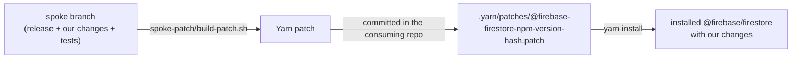
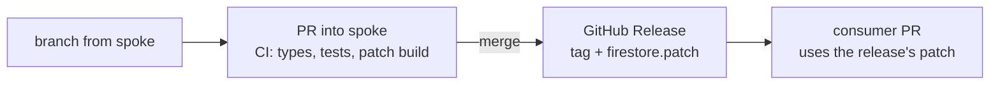

# Firestore performance patch

The `spoke` branch of this fork carries changes to `@firebase/firestore` that Spoke applies to the published package as a Yarn patch. With them, each server update costs work in proportion to what changed, instead of to every listener and document the client holds, reading a reference's `.path` again returns the string built on the first read, and parsing a lone path string or resource name keeps the array `split` returned instead of copying it twice. `patch-header.txt` describes each change, how it was checked and what it measured.

## How it fits together



What the main change does, per server update:

```diff
 for each listener's view
-  re-check every document it holds for limbo
+  re-check only the documents this update touched
```

Every patch starts with a banner naming the branch, commit and base release it was built from, and the command that rebuilds it. The rest of the header describes each change, how it was checked and what it measured.

## What the checks prove, and what they don't

| Check | What it shows |
| --- | --- |
| Firestore's unit and spec suites | Our build gives the same results as the release, in memory and with persistence |
| `view_limbo_fuzz` | The incremental limbo update matches a full recompute after every call, including keys that spell one numeric id two ways (`__id5__`, `__id05__`) |
| `view_review_cases` | Nine edge cases (malformed numeric ids, mismatched map entries, an update that throws midway) give the result recorded from the release's View |
| `key_in_filter_fuzz` | The indexed `documentId() in` / `not-in` filters match a plain `isEqual` scan, errors included |
| `doc_overloads` | `doc(collectionReference, undefined)` does not compile |
| `path.test.ts` (path strings) | After a path's string is read, its child, `popLast()` and `popFirst()` still give their own strings, though they share its segment array |
| `path_from_string` | `ResourcePath.fromString` gives upstream's segments and errors for fixed and random path strings, and a lone component with no empty segment keeps the array `split` returned |
| `build-patch.sh` base build | The release built here is byte-identical to the published package, so the patch holds only our changes |

One limit: the edge cases cover the odd states we know of. A new one in a later change shows up only if the limbo fuzz or a written case reaches it, so a change to `View` adds its own cases.

## Branches and tags

- `main` mirrors upstream `main`. Update it with GitHub's "Sync fork" and never commit to it.
- `spoke` is the default branch: upstream's latest release we use, plus our changes. `git diff firebase@<version> spoke` shows exactly what we change.
- Every push to `spoke` is a release. CI tags the commit `spoke-firestore-<version>` (`-2`, `-3` for later releases of the same version) and attaches the patch to a GitHub Release under that tag.

Upstream `main` is ahead of any release, so `spoke` only ever takes in release tags (`firebase@12.16.0`), never `main`. The patch has to apply to the package npm published, and `build-patch.sh` stops when the base build does not match it.

## What lives here

- Our changes in `packages/firestore/src`, with their tests under `packages/firestore/test/unit/core/` and `test/unit/api/`.
- `packages/firestore/rollup.shared.cjs` can load and save terser's name cache (`NC_IN`, `NC_OUT`). With both unset it builds exactly what upstream builds.
- `spoke-patch/build-patch.sh` builds the Yarn patch, and `compare-build.mjs` compares a build with the published package.
- `.github/workflows/spoke.yml` checks every pull request into `spoke` and every push to it, and uploads the built patch.
- `spoke-patch/upstream/` tracks where each change stands upstream, with ready-to-paste issue drafts in `upstream/issues/`.

## Run the tests

From the repository root, after `yarn` and `yarn --cwd packages/firestore build:deps`:

```bash
cd packages/firestore
TEST_PLATFORM=node NODE_OPTIONS=--no-experimental-strip-types \
  TS_NODE_COMPILER_OPTIONS='{"module":"commonjs"}' TS_NODE_TRANSPILE_ONLY=true \
  ../../node_modules/.bin/mocha --require ts-node/register --require ./test/register.ts \
  --config ../../config/mocharc.node.js \
  'test/unit/model/*.test.ts' 'test/unit/core/*.test.ts' 'test/unit/remote/*.test.ts' 'test/unit/specs/*.test.ts' 'test/unit/local/*.test.ts'
```

Type-check with `npx tsc --noEmit -p tsconfig.json` from `packages/firestore`; that is what runs `doc_overloads.test.ts`'s check. Errors about `gapi` under `../auth` are upstream's and unrelated.

The tests compile through ts-node because upstream's Babel 8 setup fails to load its own plugins under mocha ("template is not a function"). `build:deps` rewrites `common/api-review/`; run `git checkout -- common/api-review` before `build-patch.sh`, which needs a clean tree.

Add `USE_MOCK_PERSISTENCE=YES` and `--require ./test/util/node_persistence.ts` to run the spec and local tests with IndexedDB persistence. That needs sqlite3's native binary; if it is missing, run `npx prebuild-install -r napi` in `node_modules/sqlite3`. Compare any failure with a run on the release tag: a test that fails there too is not ours. The LRU tests named "skips a cache that is too small" fail on the `firebase@12.15.0` tag, and still fail after the `firebase@12.19.0` merge.

## Build the patch

```bash
spoke-patch/build-patch.sh firebase@12.19.0 /tmp/firestore.patch [existing.patch ...]
```

The script downloads the published package, builds the release tag and stops unless every main bundle matches the published one byte for byte. Then it builds `spoke` and writes the difference with `patch-header.txt` on top, filling in the Firestore version (from `packages/firestore/package.json`) and the release. Copy the output over the patch file in the consuming repository (for Yarn, `.yarn/patches/@firebase-firestore-npm-<version>-<hash>.patch`) and run `yarn install`. Never edit the patch by hand: change `spoke` and build it again.

### Existing patches

A package version takes one Yarn patch, so every change to Firestore belongs on `spoke`, type fixes included. Pass the consumer's current patches for the same package as extra arguments:

- A patch with the generated banner is an earlier build of this one and is replaced whole.
- Any other patch must already be part of `spoke`. The script reverse-applies it to the new build and stops unless all of its changes are there, so switching to the generated patch never drops one. To keep such a change, add it to `spoke` as its own commit with a test, then build again.

The `doc()` type fix (change 7) came from such a patch, written for 4.5.0.

## Ship a change



1. Cut a branch from `spoke` and make the change: one commit per change, each with its test, its `Spoke patch (...)` markers, and an update to every list of changes (the summary and numbered list in `patch-header.txt`, this README's intro and checks table, the table in `upstream/README.md` and the issue draft). Link the change by its fork pull request, not by commit: open the pull request, then add its link.
2. Open a pull request into `spoke`. CI type-checks, runs the unit and spec tests in memory and with persistence, and builds the patch. It must pass before merging.
3. Merge it, squashed to one commit. CI runs again on `spoke` and publishes the release.
4. In the consuming repository, replace the patch with the release's `firestore.patch`, add that repository's release entry (in web-apps, a changeset), and link the release in the pull request.

Upgrades follow the same path: the merge of the new release tag goes into `spoke` through a pull request too.

## Move to a new SDK release

1. Fetch upstream tags: `git fetch https://github.com/firebase/firebase-js-sdk.git 'refs/tags/firebase@*:refs/tags/firebase@*'`.
2. On a branch cut from `spoke`, merge the new release tag (`git merge firebase@<new>`) and open a pull request into `spoke`. Resolve conflicts in the merge commit, and drop any change upstream now ships, with a revert or in the merge itself.
3. Run the tests above. If a recorded result in `view_review_cases.test.ts` no longer holds, check what the new release's View does before updating it. Update `patch-header.txt` if a change or its evidence changed.
4. Check each `Spoke patch (...)` marker against the upstream issue it names, and drop changes upstream now ships.
5. Merge it, then replace the patch in the consuming repository with the release's `firestore.patch` as in step 4 above. If the consumer had other patches for the new version, check them first with `build-patch.sh` (see "Existing patches").

To propose a change upstream, cut a branch from the release tag and cherry-pick or rewrite that change on it.
